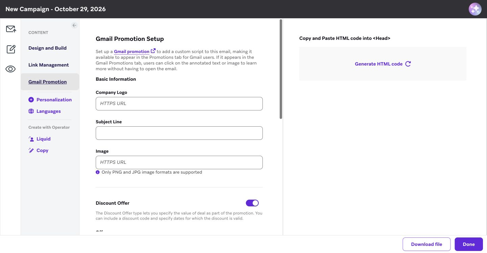
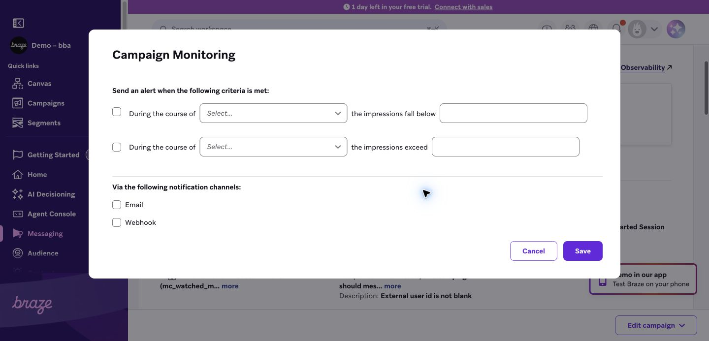

# Campaigns 对照 Braze 的复刻审计与截图归档

当前页面仍不满足 1:1 复刻。本轮记录 **79 项差异（P1 49 / P2 30）**，保存 **101 张原始 JPEG 和 101 份同名 DOM 快照**。采集日期为 2026-10-29，2026-10-30 继续完成整理。

[打开截图画廊](index.html) · [完整差异清单](FINDINGS.md) · [CSV 待办表](findings.csv) · [JSON 清单](findings.json) · [截图元数据与 SHA-256](snapshots.json)

## 主要结论

- 缺失的不只是样式：Gmail Promotion、跨工作区复制、统计队列、已上线活动分析/历史趋势、活动变更记录与监控设置，均缺少本地对应页面或入口。
- API Campaign、Feature Flag Experiment、Operator 使用了与原版不同的创建流程；Banner、LINE 也没有复刻原版全屏编辑流程。
- 已复现三类数据不一致：公共发送计划的默认 Timing 与 Review 不一致；旧草稿的转化编辑默认值与 Review 不一致；多渠道公共预览使用旧消息内容。
- Email 发送设置、IAM 的 Accessibility/KVP/优先级管理、Banner Placement、Content Card 生命周期、LINE 五条消息堆栈，以及 WhatsApp 八种布局已存在；本报告没有把这些误记为整项缺失。

## 范围与证据口径

- 对照用户给出的 Braze 工作区与 IAM 草稿链接，使用已登录 Chrome 的独立审计标签；所有渠道、公共步骤和已上线 IAM 详情均通过可见界面检查。
- 本地预览使用 127.0.0.1:3000 和隔离 SQLite：`/private/tmp/braze-channel-recheck-20261029.sqlite`。本轮本地交互仅用于复现与截图，未将应用代码修复混入审计。
- 原版主要为 1440×749，本地普通活动约 1425×741，部分全屏页为 1440×749。未统一视口和完全相同数据，因此不报告像素相似度百分比。
- 数据数量、账号名称、活动名、真实 provider 数据、试用天数和浏览器中英翻译不作为复刻问题。权限相关条目只记录当前可见状态，不推断后端权限缺陷。
- 未发布/启动活动、未发测试消息、未提交外部 Webhook、未复制或归档原版活动、未保存告警；已打开的配置弹窗以取消或关闭退出。
- 101 张指保存文件总数，不代表 101 个独立完整页面。截图是视口快照，不是整页长图；同一页不同状态可能有多张。DOM 补充未进入截图视口的字段，不能证明未呈现的像素样式。
- 当前有 97 张正常界面视口、3 张加载记录、1 张试用门槛记录。加载图不作为完整编辑器验收证据。

原版参考：[用户指定 IAM 草稿](https://dashboard-09.braze.com/engagement/campaigns/6ae2d0de5e731b00885db684/6ad0b98fe4b4110085216601?locale=en) · [Campaigns 列表](https://dashboard-09.braze.com/engagement/campaigns/campaigns/6ad0b98fe4b4110085216601?locale=en) · [已上线 IAM 分析](https://dashboard-09.braze.com/engagement/campaigns/6ad0b99b485c580061eb1dca/6ad0b98fe4b4110085216601?page=-2&locale=en)

## 差异分布

| 区域 | 项数 |
|---|---:|
| 列表与入口 | 12 |
| 公共编辑步骤 | 4 |
| 发送计划 | 8 |
| 受众 | 6 |
| 转化与摘要 | 6 |
| Email | 9 |
| Push | 3 |
| In-App Message | 3 |
| Banner | 3 |
| Content Card | 3 |
| SMS/MMS/RCS | 2 |
| Webhook | 4 |
| WhatsApp | 3 |
| LINE | 2 |
| Multichannel | 2 |
| API Campaign | 2 |
| Feature Flag Experiment | 2 |
| Operator | 1 |
| 活动详情与分析 | 4 |

## 最需要先复现的行为问题

1. **CMP-018，Timing 默认值。** 打开缺少 `delivery.timing` 的 Audit email 草稿，Schedule 下拉显示立即发送，却展开日期与频率；不改配置转到 Review，摘要是 designated times / No upcoming messages scheduled。代码定位：`app/ui/campaign-schedule.tsx` 的默认 `now` 与条件 `d.timing !== "now"`，以及 `app/ui/dashboard.tsx` 的 Review 默认 `designated`。
2. **CMP-032，转化默认值。** 使用没有 `config.conversionEvents`、旧字段为 Make Purchase 的草稿，Assign 显示 Starts Session，Review 显示 Made Purchase。代码定位：`app/ui/campaign-conversions.tsx` 与 `app/ui/dashboard.tsx` 中 `conversionEvents()` 的回退规则。
3. **CMP-070，多渠道旧预览。** Audit multichannel 的 Push 表单是 Retained push / Push remains，公共 Preview and test 却显示旧 Audit title / Hello first_name。截图 30、31 可直接对照。

## 尚未验证的分支

| 分支 | 本轮状态 / 边界 |
|---|---|
| 邮件拖拽编辑器内部 | Bee iframe 持续加载，Done 禁用；已保存两张加载记录。外层导航可核对，内部积木、拖拽、行属性不判通过或缺失。 |
| Funnel / Retention Report | Funnel 点击后提示免费试用不可用，已截图。Retention 同级入口可见但未进入，内部页面待有权限时检查。 |
| MMS / RCS / Contact Card 的真实富媒体流程 | 原账号订阅组能力限制；只比较当前可见门槛，未检验有权限后的富媒体编辑。 |
| Feature Flag 选中后的属性 | 原版无可用 flags，只验证空状态和步骤，后续属性分支待查。 |
| WhatsApp / LINE 深层消息类型 | 初始流程、类型入口及主要编辑器已检查；Carousel、Flow、Product、Flex 等全部子属性和真实 provider 行为尚未穷举。 |
| IAM 全部模板、Roku、Web 与自定义代码 | 本轮重点是传统 Mobile Modal 和现有本地编辑器；未穷举所有模板和平台组合。 |
| 发送、审批、发布、停止、归档与复制提交 | 不执行最终提交；入口和可见配置可检验，执行结果不做结论。 |
| Schedule 所有周期 / 时区 / 事件属性组合 | 主类型及主要目录已查，未穷举全部日期、时区、事件属性组合。 |
| 空列表、无搜索结果、后端失败、离线和窄屏 | 未做完整状态矩阵；本轮以当前桌面视口和成功加载状态为主。 |
| 键盘与辅助技术 | 已发现本地 Columns 用非按钮 span、部分排序缺少按钮语义、创建菜单底部不可见等风险；未做屏幕阅读器和完整 WCAG 验证。 |

因此这份清单是本轮已进入页面中观察到的完整记录，不能宣称已穷尽 Braze 所有许可、模板与平台状态。继续验收应沿上述待验证分支补齐。

## 截图主题索引

| 编号 | 页面 / 状态 | 截图数量 | 查看 |
|---|---|---:|---|
| 00 | 首次加载记录 | 1 | [画廊](index.html#topic-00) · [首张](00-braze-list-loading-blocker.jpg) |
| 01 | Campaigns 列表 | 2 | [画廊](index.html#topic-01) · [首张](01-braze-list.jpg) |
| 02 | 列表高级筛选 | 2 | [画廊](index.html#topic-02) · [首张](02-braze-filters.jpg) |
| 03 | 列表列配置 | 2 | [画廊](index.html#topic-03) · [首张](03-braze-columns.jpg) |
| 04 | 创建活动菜单 | 2 | [画廊](index.html#topic-04) · [首张](04-braze-create.jpg) |
| 05 | 公共发送计划 | 3 | [画廊](index.html#topic-05) · [首张](05-braze-schedule-current.jpg) |
| 06 | 目标受众 | 2 | [画廊](index.html#topic-06) · [首张](06-braze-audience.jpg) |
| 07 | 转化设置 | 3 | [画廊](index.html#topic-07) · [首张](07-braze-conversion-types.jpg) |
| 08 | Review Summary | 2 | [画廊](index.html#topic-08) · [首张](08-braze-review.jpg) |
| 09 | 公共 Campaign Details | 1 | [画廊](index.html#topic-09) · [首张](09-braze-compose-details.jpg) |
| 10 | 邮件发送设置 | 2 | [画廊](index.html#topic-10) · [首张](10-braze-email-sending-current.jpg) |
| 11 | 状态筛选目录 | 1 | [画廊](index.html#topic-11) · [首张](11-braze-status-options.jpg) |
| 12 | 行操作与跨工作区复制 | 2 | [画廊](index.html#topic-12) · [首张](12-braze-copy-workspace.jpg) |
| 13 | 批量操作 | 1 | [画廊](index.html#topic-13) · [首张](13-braze-bulk.jpg) |
| 14 | IAM 优先级 | 2 | [画廊](index.html#topic-14) · [首张](14-braze-priority-sorter.jpg) |
| 15 | 邮件 Advanced | 2 | [画廊](index.html#topic-15) · [首张](15-braze-email-advanced.jpg) |
| 16 | 邮件 HTML 编辑器 | 2 | [画廊](index.html#topic-16) · [首张](16-braze-email-html.jpg) |
| 17 | Gmail Promotion 缺失页 | 1 | [画廊](index.html#topic-17) · [首张](17-braze-gmail-promotion.jpg) |
| 18 | Push 编辑与平台设置 | 7 | [画廊](index.html#topic-18) · [首张](18-braze-push-all-settings.jpg) |
| 19 | Scheduled 频率 | 1 | [画廊](index.html#topic-19) · [首张](19-braze-schedule-frequency.jpg) |
| 20 | Intelligent Timing | 1 | [画廊](index.html#topic-20) · [首张](20-braze-intelligent-timing.jpg) |
| 21 | Action-Based | 2 | [画廊](index.html#topic-21) · [首张](21-braze-action-delivery.jpg) |
| 22 | API-Triggered 发送计划 | 1 | [画廊](index.html#topic-22) · [首张](22-braze-api-delivery.jpg) |
| 23 | IAM Traditional | 9 | [画廊](index.html#topic-23) · [首张](23-braze-iam-compose-controls.jpg) |
| 24 | Banner | 3 | [画廊](index.html#topic-24) · [首张](24-braze-banner-builder.jpg) |
| 25 | Content Card | 4 | [画廊](index.html#topic-25) · [首张](25-braze-content-card.jpg) |
| 26 | SMS / MMS / RCS | 4 | [画廊](index.html#topic-26) · [首张](26-braze-contact-card.jpg) |
| 27 | Webhook | 2 | [画廊](index.html#topic-27) · [首张](27-braze-webhook.jpg) |
| 28 | WhatsApp | 4 | [画廊](index.html#topic-28) · [首张](28-braze-whatsapp-layouts.jpg) |
| 29 | LINE | 2 | [画廊](index.html#topic-29) · [首张](29-braze-line-editor.jpg) |
| 30 | Multichannel | 4 | [画廊](index.html#topic-30) · [首张](30-braze-multichannel-channels.jpg) |
| 31 | Multichannel 旧预览缺陷 | 1 | [画廊](index.html#topic-31) · [首张](31-local-multichannel-stale-preview.jpg) |
| 32 | 邮件 Drag-and-drop | 4 | [画廊](index.html#topic-32) · [首张](32-braze-email-drag-loading-blocker.jpg) |
| 33 | API Campaign | 3 | [画廊](index.html#topic-33) · [首张](33-braze-api-campaign.jpg) |
| 34 | Feature Flag Experiment | 2 | [画廊](index.html#topic-34) · [首张](34-braze-feature-basics.jpg) |
| 35 | BrazeAI Operator | 2 | [画廊](index.html#topic-35) · [首张](35-braze-operator-entry-result.jpg) |
| 36 | Active Campaign Analytics | 4 | [画廊](index.html#topic-36) · [首张](36-braze-active-analytics.jpg) |
| 37 | Funnel Report 试用限制 | 1 | [画廊](index.html#topic-37) · [首张](37-braze-funnel-trial-gate.jpg) |
| 38 | 活动变更记录缺失页 | 1 | [画廊](index.html#topic-38) · [首张](38-braze-change-history.jpg) |
| 39 | Campaign Monitoring 缺失页 | 1 | [画廊](index.html#topic-39) · [首张](39-braze-campaign-monitoring.jpg) |
| 40 | User Lookup 弹窗 | 1 | [画廊](index.html#topic-40) · [首张](40-braze-user-lookup.jpg) |
| 41 | 受众筛选目录 | 2 | [画廊](index.html#topic-41) · [首张](41-braze-audience-filter-catalog.jpg) |
| 42 | Calculation Queue 缺失弹窗 | 1 | [画廊](index.html#topic-42) · [首张](42-braze-calculation-queue.jpg) |
| 43 | 受众统计展开状态 | 1 | [画廊](index.html#topic-43) · [首张](43-braze-audience-statistics.jpg) |

## 缺失页面的原版截图示例

邮件 Gmail Promotion：

活动监控设置：

## 文件校验

- Braze 截图 62 张，本地截图 39 张；JPEG 总计约 7.0 MiB。
- 每张 JPEG 均校验JPEG 文件签名、尺寸、完整性与可解码性；每张有非空同名 DOM。差异条目引用的所有证据文件均存在。
- `snapshots.json` 保存原文件 SHA-256、尺寸、文件大小和保存时间。截图以工具返回的原始 JPEG 字节保存，未重编码、裁剪或修饰。`build_report.py` 仅生成本地报告，不访问 Braze 或修改应用。
- 画廊的本地链接、图片数量、CSV 行数与内嵌 JavaScript 语法已检查。浏览器策略禁止自动导航到本地 `file://`，因此未完成画廊搜索和筛选的浏览器交互验收；HTML 文件可手动打开。
- 重新生成：在本目录运行 `python3 build_report.py`。
