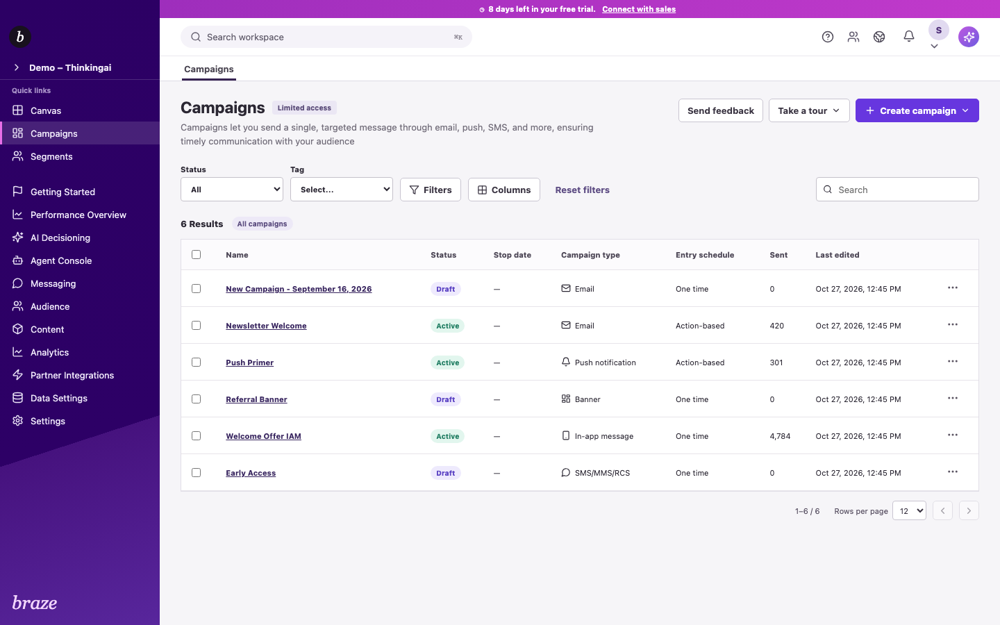
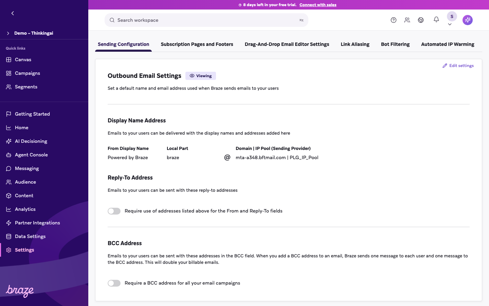
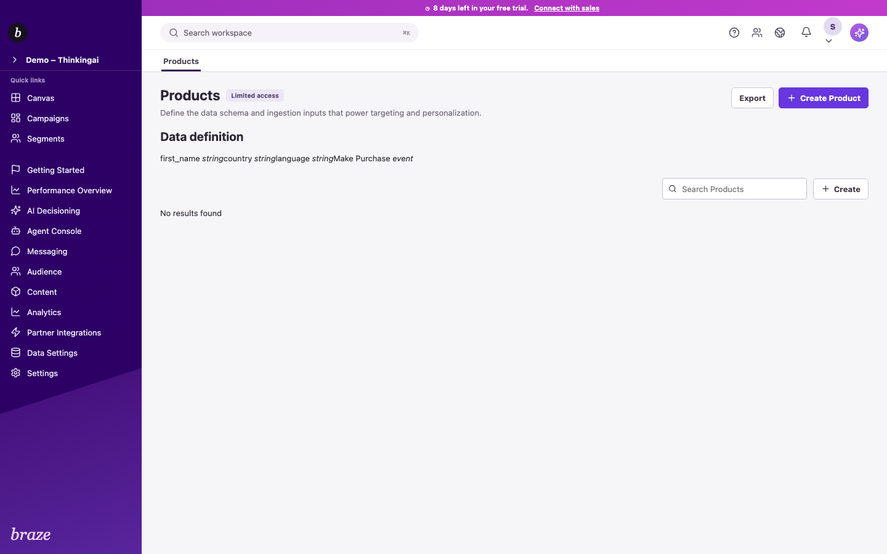

# Braze 全页面 1:1 复核（2026-10-27）

## 结论

**当前没有任何页面可以标记为完整 1:1 验收通过。** 本轮证明了路由和基础渲染稳定，但不能把它等同于视觉、字段、交互和状态与 Braze 完全一致。

- 唯一导航页面：80 个；80/80 返回 2xx。
- Campaign 渠道 Compose：13 种；13/13 可打开。
- 浏览器错误：0 个页面出现 console error 或未捕获异常。
- 1440×900 横向溢出：0 个页面。
- 直接复用通用 `ModuleWorkspace`：31 个页面，这些页面明确不满足 1:1。
- 本轮没有为 80 个页面全部取得同账号、同权限、同数据、同视口的 Braze 成对截图，因此逐像素通过数为 0。

## 验收口径

1. 页面结构：标题、导航、区块、字段、表格列、空态和权限态一致。
2. 视觉：在 1440×900、1280×800、1920×1080 下进行同状态截图差异检查。
3. 交互：创建、编辑、取消、保存、校验、筛选、排序、分页、弹窗和浏览器历史一致。
4. 数据：列表、详情、Campaign/Canvas、日志和报表读取同一份持久数据。
5. 状态：加载、空、只读、无权限、错误、成功、冲突和离开未保存状态均有证据。

本轮浏览器巡检只完整覆盖了第 1 项的可渲染性和部分第 3、4 项。没有成对证据的页面统一判定为未通过。

## 关键阻塞项

1. 31 个入口仍使用通用资源页，缺少页面专属信息架构。
2. 6 类模板页共用一套简单模板 CRUD；10 个分析入口共用 `LiveReportPage`；6 个设置入口共用字段生成页。
3. Beefree 提升了邮件编辑能力，但其界面与 Braze 原生拖拽编辑器不同，因此 Email 编辑器不能按视觉 1:1 计为通过。
4. 多数页面没有当前 Braze 账号的同权限、同数据参考；仅凭官方文档或本地功能不能确认像素和边界状态。
5. 本轮统一视口为 1440×900。除已有 IAM、SMS、WhatsApp、Email Preferences 专项证据外，移动端和另外两个桌面视口仍需补齐。

## 逐页结果

### 顶层与快捷入口

| 页面 | 运行结果 | 1:1 结论 | 主要原因 |
|---|---:|---|---|
| Canvas (`canvas`) | HTTP 200；无错误 | 未通过｜专用原型 | 有专用列表、创建向导和节点画布；仍缺完整原站节点类型、权限状态、版本与逐屏像素验收。 |
| Campaigns (`campaigns`) | HTTP 200；无错误 | 未通过｜专用原型 | 列表、筛选、列、标签和行操作已实现；没有完成同视口像素差异阈值验收。 |
| Segments (`segments`) | HTTP 200；无错误 | 未通过｜专用原型 | 有本地筛选、估算和保存；原站嵌套条件、完整操作符和状态未逐项复刻。 |
| Getting Started (`getting-started`) | HTTP 200；无错误 | 未通过｜专用原型 | 独立清单页；缺少当前 Braze 账号同页参考与状态对照。 |
| Performance Overview (`performance`) | HTTP 200；无错误 | 未通过｜专用原型 | 读取本地投递数据；指标、筛选和图表仍是本地简化结构。 |
| AI Decisioning (`ai-decisioning`) | HTTP 200；无错误 | 未通过｜通用占位 | 命中统一 ModuleWorkspace：相同配置卡、Create/Export 和通用资源 CRUD，页面专属信息架构缺失。 |
| Agent Console (`agents`) | HTTP 200；无错误 | 未通过｜通用占位 | 命中统一 ModuleWorkspace：相同配置卡、Create/Export 和通用资源 CRUD，页面专属信息架构缺失。 |
| Messaging (`messaging`) | HTTP 200；无错误 | 未通过｜通用占位 | 命中统一 ModuleWorkspace：相同配置卡、Create/Export 和通用资源 CRUD，页面专属信息架构缺失。 |
| Audience (`audience`) | HTTP 200；无错误 | 未通过｜通用占位 | 命中统一 ModuleWorkspace：相同配置卡、Create/Export 和通用资源 CRUD，页面专属信息架构缺失。 |
| Content (`content`) | HTTP 200；无错误 | 未通过｜通用占位 | 命中统一 ModuleWorkspace：相同配置卡、Create/Export 和通用资源 CRUD，页面专属信息架构缺失。 |
| Analytics (`analytics`) | HTTP 200；无错误 | 未通过｜通用占位 | 命中统一 ModuleWorkspace：相同配置卡、Create/Export 和通用资源 CRUD，页面专属信息架构缺失。 |
| Partner Integrations (`partners`) | HTTP 200；无错误 | 未通过｜通用占位 | 命中统一 ModuleWorkspace：相同配置卡、Create/Export 和通用资源 CRUD，页面专属信息架构缺失。 |
| Data Settings (`data`) | HTTP 200；无错误 | 未通过｜通用占位 | 命中统一 ModuleWorkspace：相同配置卡、Create/Export 和通用资源 CRUD，页面专属信息架构缺失。 |
| Settings (`settings`) | HTTP 200；无错误 | 未通过｜通用占位 | 命中统一 ModuleWorkspace：相同配置卡、Create/Export 和通用资源 CRUD，页面专属信息架构缺失。 |

### Messaging

| 页面 | 运行结果 | 1:1 结论 | 主要原因 |
|---|---:|---|---|
| Feature Flags (`feature-flags`) | HTTP 200；无错误 | 未通过｜通用占位 | 命中统一 ModuleWorkspace：相同配置卡、Create/Export 和通用资源 CRUD，页面专属信息架构缺失。 |
| Landing Pages (`landing-pages`) | HTTP 200；无错误 | 未通过｜通用占位 | 命中统一 ModuleWorkspace：相同配置卡、Create/Export 和通用资源 CRUD，页面专属信息架构缺失。 |
| Surveys (`surveys`) | HTTP 200；无错误 | 未通过｜通用占位 | 命中统一 ModuleWorkspace：相同配置卡、Create/Export 和通用资源 CRUD，页面专属信息架构缺失。 |
| Banners (`banners`) | HTTP 200；无错误 | 未通过｜通用占位 | 命中统一 ModuleWorkspace：相同配置卡、Create/Export 和通用资源 CRUD，页面专属信息架构缺失。 |
| Content Calendar (`content-calendar`) | HTTP 200；无错误 | 未通过｜通用占位 | 命中统一 ModuleWorkspace：相同配置卡、Create/Export 和通用资源 CRUD，页面专属信息架构缺失。 |
| Messaging Diagnostics (`messaging-diagnostics`) | HTTP 200；无错误 | 未通过｜通用占位 | 命中统一 ModuleWorkspace：相同配置卡、Create/Export 和通用资源 CRUD，页面专属信息架构缺失。 |

### Audience

| 页面 | 运行结果 | 1:1 结论 | 主要原因 |
|---|---:|---|---|
| Segment Extensions (`segment-extensions`) | HTTP 200；无错误 | 未通过｜专用原型 | 有独立页面或本地功能，但缺少当前 Braze 同页、同权限、同数据状态的完整成对验收。 |
| Global Control Group (`global-control-group`) | HTTP 200；无错误 | 未通过｜核心结构接近 | 已按真实页面重建主要区块并接入本地逻辑；控件、权限和全部状态未逐像素通过。 |
| Suppression Lists (`suppression-lists`) | HTTP 200；无错误 | 未通过｜专用原型 | 有独立页面或本地功能，但缺少当前 Braze 同页、同权限、同数据状态的完整成对验收。 |
| Subscription Group Management (`subscription-group-management`) | HTTP 200；无错误 | 未通过｜专用原型 | 列表、创建、详情、成员与活动已实现；原站时间序列、渠道差异和全部弹窗状态不完整。 |
| Email Preference Centers (`email-preference-centers`) | HTTP 200；无错误 | 未通过｜专用原型 | 列表、创建和编辑器已实现；发布后状态、权限组合和原站编辑器细节未完整验收。 |
| Search Users (`search-users`) | HTTP 200；无错误 | 未通过｜专用原型 | 有查询和用户档案；设备、事件、订阅和原站全部详情页签仍不完整。 |
| Manage Audience (`manage-audience`) | HTTP 200；无错误 | 未通过｜通用占位 | 命中统一 ModuleWorkspace：相同配置卡、Create/Export 和通用资源 CRUD，页面专属信息架构缺失。 |
| Import Users (`import-users`) | HTTP 200；无错误 | 未通过｜专用原型 | 有独立页面或本地功能，但缺少当前 Braze 同页、同权限、同数据状态的完整成对验收。 |
| Locations (`locations`) | HTTP 200；无错误 | 未通过｜专用原型 | 有独立页面或本地功能，但缺少当前 Braze 同页、同权限、同数据状态的完整成对验收。 |

### Content

| 页面 | 运行结果 | 1:1 结论 | 主要原因 |
|---|---:|---|---|
| Media Library (`media-library`) | HTTP 200；无错误 | 未通过｜专用原型 | 有独立页面或本地功能，但缺少当前 Braze 同页、同权限、同数据状态的完整成对验收。 |
| Banner Templates (`banner-templates`) | HTTP 200；无错误 | 未通过｜共用模板页 | 与其他模板类型共用 TemplatesWorkspace，缺少该模板类型的原站列表、筛选、状态和编辑流程。 |
| Canvas Templates (`canvas-templates`) | HTTP 200；无错误 | 未通过｜共用模板页 | 与其他模板类型共用 TemplatesWorkspace，缺少该模板类型的原站列表、筛选、状态和编辑流程。 |
| Content Blocks (`content-blocks`) | HTTP 200；无错误 | 未通过｜专用原型 | 有独立页面或本地功能，但缺少当前 Braze 同页、同权限、同数据状态的完整成对验收。 |
| Email Link Templates (`email-link-templates`) | HTTP 200；无错误 | 未通过｜共用模板页 | 与其他模板类型共用 TemplatesWorkspace，缺少该模板类型的原站列表、筛选、状态和编辑流程。 |
| Email Templates (`email-templates`) | HTTP 200；无错误 | 未通过｜共用模板页 | 与其他模板类型共用 TemplatesWorkspace，缺少该模板类型的原站列表、筛选、状态和编辑流程。 |
| In-App Message Templates (`in-app-message-templates`) | HTTP 200；无错误 | 未通过｜共用模板页 | 与其他模板类型共用 TemplatesWorkspace，缺少该模板类型的原站列表、筛选、状态和编辑流程。 |
| Webhook Templates (`webhook-templates`) | HTTP 200；无错误 | 未通过｜共用模板页 | 与其他模板类型共用 TemplatesWorkspace，缺少该模板类型的原站列表、筛选、状态和编辑流程。 |
| Promotion Codes (`promotion-codes`) | HTTP 200；无错误 | 未通过｜专用原型 | 有独立页面或本地功能，但缺少当前 Braze 同页、同权限、同数据状态的完整成对验收。 |
| Catalogs (`catalogs`) | HTTP 200；无错误 | 未通过｜核心结构接近 | 已有真实页面专项对照和核心工作流；现有审计仍记录搜索触发、订阅表格、说明文案和可编辑权限缺口。 |
| Brand Guidelines (`brand-guidelines`) | HTTP 200；无错误 | 未通过｜专用原型 | 有独立页面或本地功能，但缺少当前 Braze 同页、同权限、同数据状态的完整成对验收。 |

### Analytics

| 页面 | 运行结果 | 1:1 结论 | 主要原因 |
|---|---:|---|---|
| Report Builder (`report-builder`) | HTTP 200；无错误 | 未通过｜专用原型 | 有独立页面或本地功能，但缺少当前 Braze 同页、同权限、同数据状态的完整成对验收。 |
| Custom Events Report (`custom-events-report`) | HTTP 200；无错误 | 未通过｜共用报表页 | 与其他分析入口共用 LiveReportPage，仅切换少量指标或表格，未还原各报表的专属筛选和钻取。 |
| Global Control Group Report (`global-control-group-report`) | HTTP 200；无错误 | 未通过｜共用报表页 | 与其他分析入口共用 LiveReportPage，仅切换少量指标或表格，未还原各报表的专属筛选和钻取。 |
| Query Builder (`query-builder`) | HTTP 200；无错误 | 未通过｜专用原型 | 有独立页面或本地功能，但缺少当前 Braze 同页、同权限、同数据状态的完整成对验收。 |
| Engagement Reports (`engagement-reports`) | HTTP 200；无错误 | 未通过｜共用报表页 | 与其他分析入口共用 LiveReportPage，仅切换少量指标或表格，未还原各报表的专属筛选和钻取。 |
| Revenue Report (`revenue-report`) | HTTP 200；无错误 | 未通过｜共用报表页 | 与其他分析入口共用 LiveReportPage，仅切换少量指标或表格，未还原各报表的专属筛选和钻取。 |
| Segment Insights (`segment-insights`) | HTTP 200；无错误 | 未通过｜共用报表页 | 与其他分析入口共用 LiveReportPage，仅切换少量指标或表格，未还原各报表的专属筛选和钻取。 |
| Dashboard Builder (`dashboard-builder`) | HTTP 200；无错误 | 未通过｜共用报表页 | 与其他分析入口共用 LiveReportPage，仅切换少量指标或表格，未还原各报表的专属筛选和钻取。 |
| Email Performance (`email-performance`) | HTTP 200；无错误 | 未通过｜共用报表页 | 与其他分析入口共用 LiveReportPage，仅切换少量指标或表格，未还原各报表的专属筛选和钻取。 |
| Push Performance (`push-performance`) | HTTP 200；无错误 | 未通过｜共用报表页 | 与其他分析入口共用 LiveReportPage，仅切换少量指标或表格，未还原各报表的专属筛选和钻取。 |
| SMS/MMS/RCS Performance (`sms-mms-rcs-performance`) | HTTP 200；无错误 | 未通过｜共用报表页 | 与其他分析入口共用 LiveReportPage，仅切换少量指标或表格，未还原各报表的专属筛选和钻取。 |
| Conversions (`conversions`) | HTTP 200；无错误 | 未通过｜共用报表页 | 与其他分析入口共用 LiveReportPage，仅切换少量指标或表格，未还原各报表的专属筛选和钻取。 |

### Partner Integrations

| 页面 | 运行结果 | 1:1 结论 | 主要原因 |
|---|---:|---|---|
| Technology Partners (`technology-partners`) | HTTP 200；无错误 | 未通过｜通用占位 | 命中统一 ModuleWorkspace：相同配置卡、Create/Export 和通用资源 CRUD，页面专属信息架构缺失。 |
| Currents (`currents`) | HTTP 200；无错误 | 未通过｜通用占位 | 命中统一 ModuleWorkspace：相同配置卡、Create/Export 和通用资源 CRUD，页面专属信息架构缺失。 |
| Data Sharing (`data-sharing`) | HTTP 200；无错误 | 未通过｜通用占位 | 命中统一 ModuleWorkspace：相同配置卡、Create/Export 和通用资源 CRUD，页面专属信息架构缺失。 |
| Solutions Partners (`solutions-partners`) | HTTP 200；无错误 | 未通过｜通用占位 | 命中统一 ModuleWorkspace：相同配置卡、Create/Export 和通用资源 CRUD，页面专属信息架构缺失。 |

### Data Settings

| 页面 | 运行结果 | 1:1 结论 | 主要原因 |
|---|---:|---|---|
| Custom Attributes (`custom-attributes`) | HTTP 200；无错误 | 未通过｜专用原型 | 有独立页面或本地功能，但缺少当前 Braze 同页、同权限、同数据状态的完整成对验收。 |
| Custom Events (`custom-events`) | HTTP 200；无错误 | 未通过｜专用原型 | 有独立页面或本地功能，但缺少当前 Braze 同页、同权限、同数据状态的完整成对验收。 |
| Products (`products`) | HTTP 200；无错误 | 未通过｜通用占位 | 命中统一 ModuleWorkspace：相同配置卡、Create/Export 和通用资源 CRUD，页面专属信息架构缺失。 |
| Cloud Data Ingestion (`cloud-data-ingestion`) | HTTP 200；无错误 | 未通过｜通用占位 | 命中统一 ModuleWorkspace：相同配置卡、Create/Export 和通用资源 CRUD，页面专属信息架构缺失。 |
| Data Transformation (`data-transformation`) | HTTP 200；无错误 | 未通过｜通用占位 | 命中统一 ModuleWorkspace：相同配置卡、Create/Export 和通用资源 CRUD，页面专属信息架构缺失。 |

### Settings

| 页面 | 运行结果 | 1:1 结论 | 主要原因 |
|---|---:|---|---|
| App Settings (`app-settings`) | HTTP 200；无错误 | 未通过｜共用设置页 | 由 PersistedSettingsPage 按少量字段生成，缺少原站页面结构、权限、校验和审计状态。 |
| APIs and Identifiers (`apis-and-identifiers`) | HTTP 200；无错误 | 未通过｜专用原型 | 有独立页面或本地功能，但缺少当前 Braze 同页、同权限、同数据状态的完整成对验收。 |
| Message Activity Log (`message-activity-log`) | HTTP 200；无错误 | 未通过｜专用原型 | 读取真实本地事件；字段、筛选、详情和导出能力未与原站完整对照。 |
| Event User Log (`event-user-log`) | HTTP 200；无错误 | 未通过｜通用占位 | 命中统一 ModuleWorkspace：相同配置卡、Create/Export 和通用资源 CRUD，页面专属信息架构缺失。 |
| Internal Groups (`internal-groups`) | HTTP 200；无错误 | 未通过｜通用占位 | 命中统一 ModuleWorkspace：相同配置卡、Create/Export 和通用资源 CRUD，页面专属信息架构缺失。 |
| Exports Log (`exports-log`) | HTTP 200；无错误 | 未通过｜通用占位 | 命中统一 ModuleWorkspace：相同配置卡、Create/Export 和通用资源 CRUD，页面专属信息架构缺失。 |
| Tag Management (`tag-management`) | HTTP 200；无错误 | 未通过｜专用原型 | 专用标签管理和 Campaign 联动已实现；没有原站成对截图和完整权限状态。 |
| Email Preferences (`email-preferences`) | HTTP 200；无错误 | 未通过｜核心结构接近 | 六个页签已有成对参考和专项修复；参考账号缺少部分编辑权限，仍不能声明全部状态 1:1。 |
| Frequency Capping Rules (`frequency-capping-rules`) | HTTP 200；无错误 | 未通过｜专用原型 | 有独立页面或本地功能，但缺少当前 Braze 同页、同权限、同数据状态的完整成对验收。 |
| Push Settings (`push-settings`) | HTTP 200；无错误 | 未通过｜共用设置页 | 由 PersistedSettingsPage 按少量字段生成，缺少原站页面结构、权限、校验和审计状态。 |
| Approval Workflow (`approval-workflow`) | HTTP 200；无错误 | 未通过｜通用占位 | 命中统一 ModuleWorkspace：相同配置卡、Create/Export 和通用资源 CRUD，页面专属信息架构缺失。 |
| Localization Settings (`localization-settings`) | HTTP 200；无错误 | 未通过｜共用设置页 | 由 PersistedSettingsPage 按少量字段生成，缺少原站页面结构、权限、校验和审计状态。 |
| Banner Placements (`banner-placements`) | HTTP 200；无错误 | 未通过｜共用设置页 | 由 PersistedSettingsPage 按少量字段生成，缺少原站页面结构、权限、校验和审计状态。 |
| Messaging Rate Limits (`messaging-rate-limits`) | HTTP 200；无错误 | 未通过｜共用设置页 | 由 PersistedSettingsPage 按少量字段生成，缺少原站页面结构、权限、校验和审计状态。 |
| Billing (`billing`) | HTTP 200；无错误 | 未通过｜共用设置页 | 由 PersistedSettingsPage 按少量字段生成，缺少原站页面结构、权限、校验和审计状态。 |
| User Management (`user-management`) | HTTP 200；无错误 | 未通过｜通用占位 | 命中统一 ModuleWorkspace：相同配置卡、Create/Export 和通用资源 CRUD，页面专属信息架构缺失。 |

### Agent Console

| 页面 | 运行结果 | 1:1 结论 | 主要原因 |
|---|---:|---|---|
| Canvas Step Agents (`canvas-step-agents`) | HTTP 200；无错误 | 未通过｜通用占位 | 命中统一 ModuleWorkspace：相同配置卡、Create/Export 和通用资源 CRUD，页面专属信息架构缺失。 |
| Data Agents (`data-agents`) | HTTP 200；无错误 | 未通过｜通用占位 | 命中统一 ModuleWorkspace：相同配置卡、Create/Export 和通用资源 CRUD，页面专属信息架构缺失。 |
| Catalog Agents (`catalog-agents`) | HTTP 200；无错误 | 未通过｜通用占位 | 命中统一 ModuleWorkspace：相同配置卡、Create/Export 和通用资源 CRUD，页面专属信息架构缺失。 |

## Campaign 渠道 Compose

| 渠道 | 运行结果 | 1:1 结论 | 主要差异 |
|---|---:|---|---|
| email | HTTP 200；无错误 | 未通过｜部分还原 | 五步 Campaign 流程与发送配置为专用实现；新拖拽编辑器使用 Beefree SDK，编辑器 UI 本身不会与 Braze 原生编辑器 1:1。 |
| push | HTTP 200；无错误 | 未通过｜部分还原 | 有平台、翻译、图片和高级字段；未完成 iOS/Android/Web 的全部原站状态和像素验收。 |
| iam | HTTP 200；无错误 | 未通过｜核心流程接近 | Compose、Settings、Preview 与核心模板有较完整原站证据；传统编辑器、模板管理、表单高级行为和移动像素仍有缺口。 |
| content | HTTP 200；无错误 | 未通过｜部分还原 | 有 Content Card 专用字段与预览，仍是简化实现。 |
| banner | HTTP 200；无错误 | 未通过｜部分还原 | 有 Placement、内容和预览，仍缺原站完整配置与运行状态。 |
| sms | HTTP 200；无错误 | 未通过｜核心流程接近 | 订阅组、分段、Liquid、媒体和测试已实现并有专项对照；权限分支和全部细节未完成。 |
| webhook | HTTP 200；无错误 | 未通过｜部分还原 | 结构化请求、Liquid、测试和审计闭环可用；原站视觉、鉴权组合与失败状态未全部对照。 |
| whatsapp | HTTP 200；无错误 | 未通过｜核心流程接近 | 模板、响应布局、媒体、测试和 Canvas 联动已有专项对照；Flow/Product 及全部权限状态未完成。 |
| line | HTTP 200；无错误 | 未通过｜部分还原 | 专用表单可用，但账号、模板、富消息和投递状态为简化实现。 |
| multichannel | HTTP 200；无错误 | 未通过｜部分还原 | 仅提供协调配置原型，未还原真实多渠道编排流程。 |
| operator | HTTP 200；无错误 | 未通过｜部分还原 | 本地生成草稿原型，未还原 BrazeAI Operator 的真实会话与结果状态。 |
| feature | HTTP 200；无错误 | 未通过｜部分还原 | 有实验基础字段，缺少真实 Feature Flag 选择、分流、版本和结果页。 |
| api | HTTP 200；无错误 | 未通过｜部分还原 | 有 API Campaign 基础字段，缺少原站标识符、触发、验证与分析详情。 |

## 代表性运行截图

### 专用页面

### 通用占位页面示例

Products 页面直接显示统一的 Data definition 与资源 CRUD，不能视为 Braze Products 页面复刻：

## 原始证据

- [80 个页面与 13 种渠道的浏览器运行结果](audits/full-page-2026-10-27/runtime-results.json)
- [Email Preferences 专项差异与修复](email-preferences-fix-report-2026-10-17.md)
- [Catalogs 差异复核](catalogs-gap-audit-2026-09-17.md)
- [IAM 实现与能力边界](in-app-message-implementation-2026-10-27.md)
- [WhatsApp QA](whatsapp-reference/qa.md)
- [SMS 设计 QA](sms-reference/design-qa.md)

## 建议修复顺序

1. 先替换 31 个 `ModuleWorkspace` 页面，从真实 Braze 页面采集列表、详情、创建和权限态证据。
2. 拆分模板、分析和设置共享页，使每个入口拥有独立字段、空态、筛选和详情流程。
3. 明确 Email 编辑器目标：若要求 Braze 视觉 1:1，需要在 Beefree 外再实现 Braze 风格壳层和交互映射；直接嵌入 Beefree 只能保证编辑能力。
4. 对 Campaign、Canvas、Catalogs、Email Preferences、IAM、SMS、WhatsApp 建立 1440×900、1280×800、1920×1080 的成对截图阈值。
5. 补齐加载、空、错误、只读、无权限、保存冲突和未保存离开状态，再逐页改为“验收通过”。
