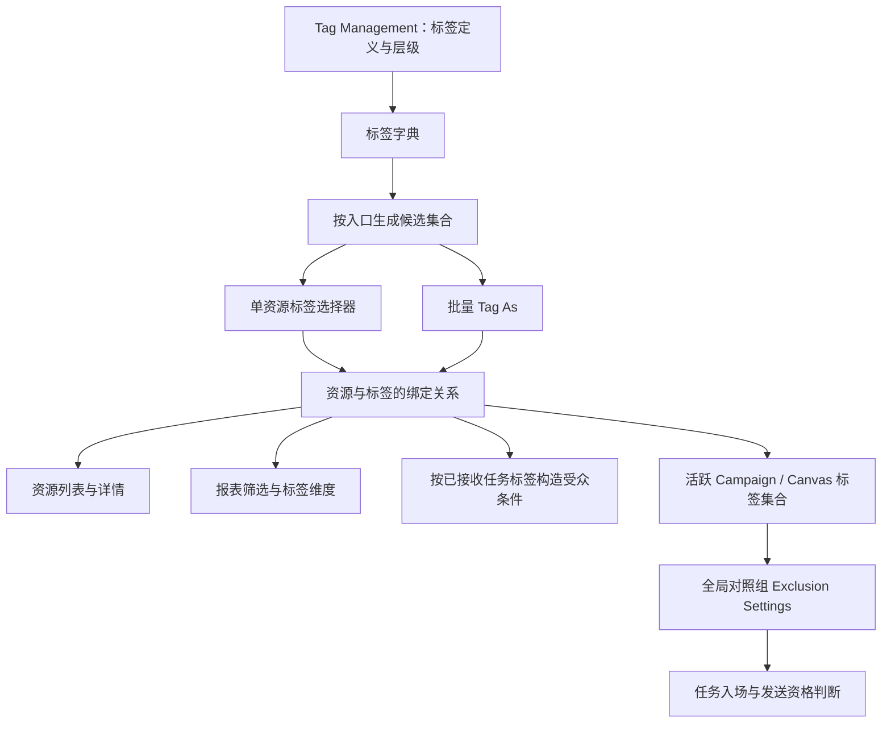
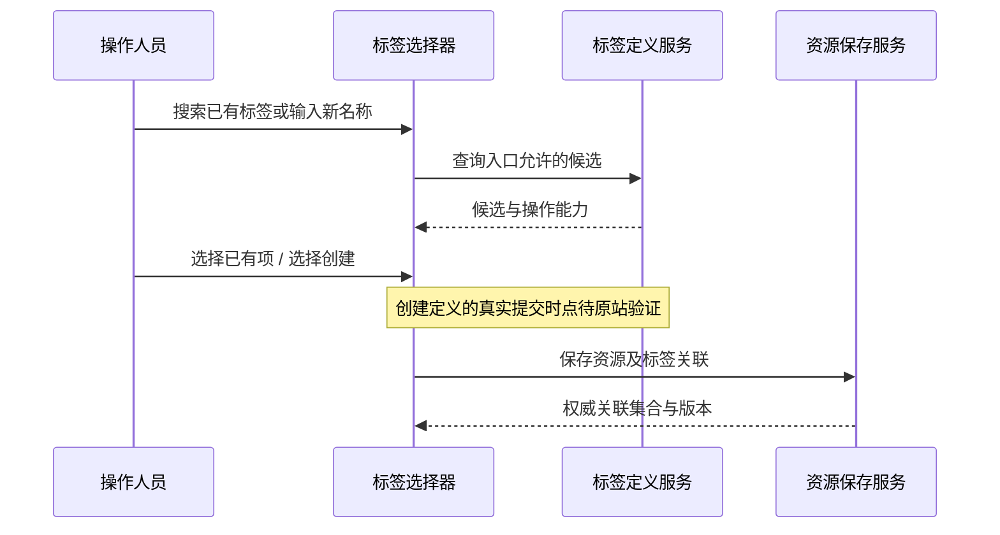
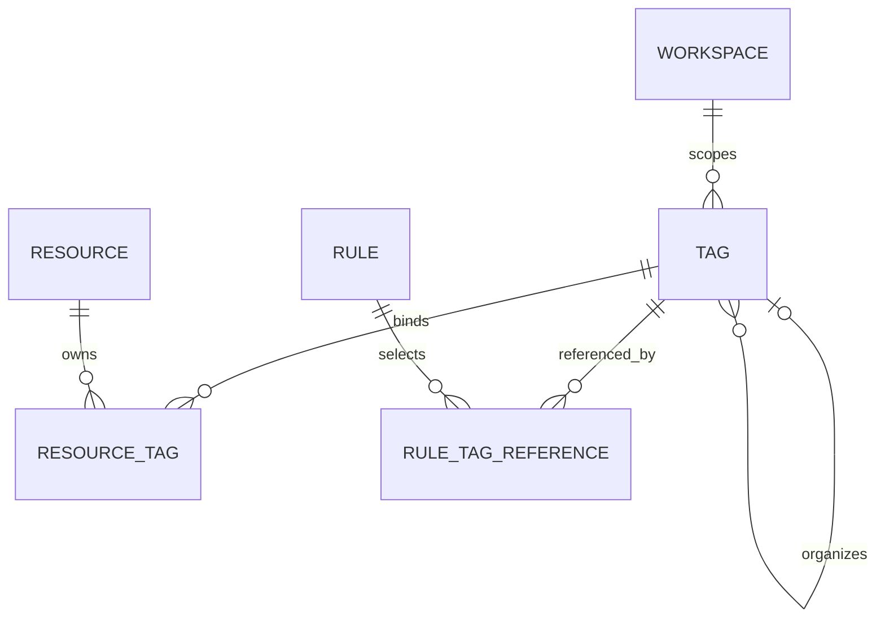

# Braze Tag 体系：逻辑架构与复刻依据

日期：2026-10-22
阶段：先完成逻辑梳理，作为后续 1:1 复刻的依据。
代码基线：`main` / `b477cbf`，加当前工作区尚未提交的全局对照组改动。

## 1. 核心结论与证据边界

Braze 的 Tag 体系可以从产品行为上分成五部分：标签管理、资源绑定、场景化候选、查询与报表消费、发送规则消费。后续复刻需要覆盖这条链路，不能仅实现一个标签输入框。

本文使用三种标记：

- **已确认**：有官方文档或当前仓库代码直接支持。
- **架构建议**：为复刻设计的模型、接口和一致性策略，不代表 Braze 内部实现。
- **待验证**：公开材料不能确定，需要登录态原站交互验证后再定实现。

本轮以官方文档研究和代码阅读为主，未在 Braze 中新增、重命名、删除或批量修改标签。没有取得 Tag Management 的完整登录态交互证据，因此本文不是页面像素验收报告。标签 ID、数据库结构、内部服务划分也没有官方公开证据，下文相应内容均为复刻建议。

## 2. 先明确 Tag 指的是什么

| 概念 | 作用对象 | 与本次复刻的关系 |
| --- | --- | --- |
| 运营资源 Tag | Campaign、Canvas、Segment 等资源 | 本次核心：组织、检索和规则引用 |
| 数据字典 Tag | 自定义属性定义、自定义事件定义 | 扩展范围；不要理解成给某个用户或某条事件打标签 |
| 用户属性/用户分群 | 用户档案及人群条件 | 独立模型；不能因为用户进入某个 Segment，就自动把其资源 Tag 写入用户档案 |
| Draft / Archived 等状态标记 | 资源状态 | UI 可以同样显示为胶囊，但应与真正的 Tag 区分类型 |
| Liquid tag / HTML tag | 模板语法或标记语言 | 与运营标签字典分别建模 |

状态名称是否允许同时作为普通标签名，仍需验证；不能仅因存在 `Draft` 状态就自行禁止创建同名 Tag。

## 3. 已确认的产品范围与规则

| 编号 | 已确认规则 | 直接依据 |
| --- | --- | --- |
| F01 | Campaign、Canvas、Segment 支持绑定多个标签；可从编辑入口选已有标签或输入新标签 | [官方 Tags](https://www.braze.com/docs/user_guide/messaging/governance/tags) |
| F02 | 上述三类资源每个最多 175 个标签；不能把该上限未经验证地扩展到所有资源类型 | [官方 Tags](https://www.braze.com/docs/user_guide/messaging/governance/tags) |
| F03 | 支持列表按标签筛选、详情展示，以及多选资源后的 Tag As 批量操作 | [官方 Tags](https://www.braze.com/docs/user_guide/messaging/governance/tags) |
| F04 | 官方特别说明：批量给多个 Campaign 加新标签时，选中 Campaign 原有标签也会相互传播 | [官方 Tags：Bulk tagging](https://www.braze.com/docs/user_guide/messaging/governance/tags#bulk-tagging) |
| F05 | 自定义属性、自定义事件支持元数据标签；该标签能力在 Tags 指南中标记为 Early Access | [官方 Tags](https://www.braze.com/docs/user_guide/messaging/governance/tags#custom-data-tags) |
| F06 | Settings → Tag Management 是集中管理入口，支持新增、改名、移除标签 | [官方 Managing tags](https://www.braze.com/docs/user_guide/administer/global/workspace_settings/tags) |
| F07 | 支持 Nest Tag Under；新建和编辑现有标签时均可选择父标签 | [官方 Managing tags：Nesting tags](https://www.braze.com/docs/user_guide/administer/global/workspace_settings/tags#nesting-tags) |
| F08 | 被用到的父标签不一定出现在父标签候选中；官方描述了仅作为嵌套依赖存在时，需要单独创建才能被检索的情况 | [官方 Managing tags](https://www.braze.com/docs/user_guide/administer/global/workspace_settings/tags#parent-tag-is-in-use-but-missing-from-nest-tag-under) |
| F09 | 存在 View Tags、Edit Tags、Delete Tags 权限；分别覆盖查看、创建/更新、永久删除 | [官方 Permissions](https://www.braze.com/docs/user_guide/administer/global/user_management/permissions?sdktab=granular+permissions) |
| F10 | 邮件模板 API 的 `tags` 为字符串数组，要求引用已有标签 | [Create Email Templates](https://www.braze.com/docs/api/endpoints/templates/email_templates/post_create_email_template) |
| F11 | Content Block 创建 API 同样要求其 `tags` 已存在；它还单独返回 `liquid_tag`，两种 tag 不能混淆 | [Create Content Block](https://www.braze.com/docs/api/endpoints/templates/content_blocks_templates/post_create_email_content_block) |

F08 表明“可以显示在层级中的节点”和“可作为显式父标签被选择的项”可能不是完全相同的集合。不能据此直接断言 Braze 内部存在某个特定字段或数据库表。

## 4. 产品逻辑架构

以下是依据上述行为整理的**逻辑分层**，不是 Braze 官方服务拓扑。



### 4.1 五个部分分别负责什么

| 部分 | 职责 | 不应承担的职责 |
| --- | --- | --- |
| 标签字典 | 定义名称、层级、身份与可用状态 | 不直接决定用户是否收到消息 |
| 资源绑定 | 描述哪个资源使用哪些标签 | 不把资源状态、用户分群条件混入标签 |
| 候选服务 | 依据入口、权限、资源类型和状态返回可选项 | 不强迫所有页面使用同一份无条件下拉列表 |
| 查询与分析 | 资源检索、筛选、报表分组及规则引用 | 不把多个标签分组简单相加当成去重总量 |
| 执行规则 | 在具体规则中消费任务的标签 | 不把所有标签都解释成发送豁免 |

按 workspace 隔离核心资源标签，是本项目的建模建议；跨 workspace 复制、共享资产和标签映射行为仍需专门验证。不能仅从页面 URL 或 API 字符串数组推断 Braze 的内部租户键。

### 4.2 资源绑定与“使用该资源”应分开

建议显式记录 `resource → tag` 关系，不沿资源依赖自动复制标签：

- Campaign 使用了某个 Segment，并不在本项目设计中自动继承其标签。
- Canvas 的标签绑定在 Canvas 资源上；不能用节点文案或渠道名称替代它。
- 选用了带标签的邮件模板，不应未经验证就把模板标签复制给 Campaign。

以上是**防止隐式传播的实现建议**。原站是否在某些复制、模板或批量入口传播标签，须逐入口实测，不能把这些建议当成已确认的 Braze 规则。

## 5. 不同入口有不同的标签候选规则

| 入口 | 已确认能力或候选来源 | 复刻时需要保留的区别 |
| --- | --- | --- |
| Tag Management | 管理标签定义与嵌套 | 管理定义，不等于绑定到任务 |
| Campaign / Canvas / Segment 编辑器 | 选择已有项，也支持新建 | 新建与关联是两个逻辑动作；具体落库时点待验证 |
| 邮件模板、Content Block 创建 API | 只能引用已有项 | 不可把未知字符串静默创建为新标签 |
| 全局对照组排除设置 | 只显示至少一个活跃 Campaign 或 Canvas 正在使用的标签 | 不是完整标签字典，也不由 Segment 标签单独贡献候选 |
| 普通列表筛选 | 按资源标签筛选 | 是否包含未使用、归档对象使用的项及多选语义待验证 |
| Nest Tag Under | 选择父标签；有 F08 的显式/依赖节点差异 | 不能直接把当前全部节点原样作为父节点候选 |

全局对照组候选限制来自 [Global Control Group 官方说明](https://www.braze.com/docs/user_guide/audience/global_control_group#step-3-assign-exclusion-settings)。模板与 Content Block 的差异分别见 F10、F11。

**架构建议**：共享候选接口支持 `context` 参数，由服务端计算入口资格；前端只做搜索、展开和选择展示。候选集合与已经保存的选择值分开返回，避免某标签暂时失去候选资格后，前端加载时悄悄删除已有规则。

## 6. 关键操作及其保存语义

### 6.1 新建与绑定



**待验证的保存边界**：输入名称后按 Enter，究竟立即创建字典项，还是到保存资源才创建？关闭草稿后，该项是否仍能在 Tag Management 被搜索到？这决定是否需要处理未关联标签和跨页面刷新，不能直接沿用当前各页面的临时字符串数组。

### 6.2 批量打标：必须单独实现与验证

F04 的可测试示例：

```text
操作前：Campaign A = {Promo}
        Campaign B = {Transactional}
批量添加：Launch

根据官方对 Campaign 的描述，操作后两者均有：
{Promo, Transactional, Launch}
```

这里不能直接复用“每条资源各自追加一个标签”的常规批量函数。建议为批量动作建立独立命令，先计算每条资源的最终集合，再整体校验上限并提交。

该例中若 `Transactional` 被全局对照组排除规则引用，A 的资格也可能因标签传播而改变。这是两个功能联动的推导，不是新增一条 Braze 标签规则。

**待验证**：Canvas、Segment 是否完全采用同一批量合并语义；批量移除如何处理；跨页全选是否覆盖全部查询结果。官方的这条传播说明明确使用 Campaign 举例，本文不扩大认定。

### 6.3 改名与调整父级

已确认管理入口支持这些编辑能力，但以下传播细节未确认：引用方按 ID 还是名称保存、旧名称是否还能搜索、报表是否回溯改名、GCG 例外是否继续关联。

**架构建议**：

1. 标签有稳定身份，名称及显示路径可以变化。
2. 资源与规则引用稳定身份，显示时解析最新名称。
3. 改名后统一刷新编辑器、列表、候选缓存和使用位置。
4. 调整父级前检查跨 workspace 引用和循环；子树处理方式按原站实测结果实现。
5. 名称碰撞时不擅自合并两个标签。

### 6.4 从资源移除与全局删除

这两个动作在本项目模型中必须拆开：解绑只改变某条关系；全局删除则处理标签定义及其引用。权限文档使用永久删除语义，不应自行给原站 UI 增加一个已确认存在的“标签回收站”。

**待验证**：原站删除是否被使用中的引用阻止，是否级联解绑，如何处理子标签、GCG 规则和已保存报表。后续实施前应先取得这些行为证据；目前不决定级联删除策略。

## 7. 父子标签：组织结构与业务匹配分别验证

假设存在层级：

```text
Lifecycle
├── Onboarding
└── Retention
```

已确认可以组织成父子关系；以下推论**尚未确认**：

- 任务仅绑定 `Onboarding` 时，是否同时算绑定了 `Lifecycle`。
- 搜索或筛选 `Lifecycle` 是否自动包含全部后代。
- GCG 排除配置 `Lifecycle` 时，是否放行只绑定子标签的任务。
- 层级最大深度、同一叶名称能否出现在不同父级下、路径分隔符及重命名显示规则。

**架构建议**：分别保存直接关联与层级关系；查询层显式区分“直接命中”和“包含后代”。在原站证据补齐前，不用路径字符串前缀匹配来实现发送豁免。

## 8. 与全局对照组、受众规则和报表的关系

### 8.1 全局对照组

已确认：任务命中排除配置中的任意标签，就不受该全局组限制；常规情况下，全局组成员在 Campaign / Canvas 入场前被过滤。依据：[Global Control Group](https://www.braze.com/docs/user_guide/audience/global_control_group)。

用于说明逻辑的伪代码：

```text
task_tags = 读取当前任务的标签关联
exception_tags = 读取当前 GCG 排除配置
tag_exempt = 两个集合存在交集

global_holdout = GCG已启用 AND 用户属于全局组 AND NOT tag_exempt
```

API Campaign 的例外及 Content Card 特殊处理属于 GCG 执行规则，不应混入通用标签字典。标签豁免也不是覆盖订阅、受众条件等全部资格检查的总开关。

对复刻模型的要求：GCG 保存的是“引用哪些标签”，不是创建一份独立的标签库。改名、删除、父子结构和批量操作都要有跨模块验收。

### 8.2 按已接收任务标签构造受众条件

官方给出了按某类已接收 Campaign 的标签与时间条件限制触达频率的用法，也介绍了按标签配置 Engagement Report。依据：[Managing tags：Use cases](https://www.braze.com/docs/user_guide/administer/global/workspace_settings/tags#use-cases)。

逻辑上涉及三类数据：任务的标签、用户的接收历史、受众条件。应区别于“标签自己就是一条通用频控规则”。任务后来改标签时，历史接收筛选使用旧关系还是新关系，仍待验证。

### 8.3 报表

Report Builder 支持以 Tags 为行维度、展示任务标签列，并在选取任务时用标签筛选；自动选择规则还可以让后续满足条件的任务进入未来报表运行。依据：[Report Builder](https://www.braze.com/docs/user_guide/analytics/reports/report_builder)。

**架构建议**：区分按标签分组与按标签选任务。一个任务有多个标签时，多个标签行可能覆盖同一条任务；不能无条件相加成整体去重总量。标签改名、删除、重新绑定对历史分组的影响，须单独核对。

## 9. 对外接口能证明什么

| 官方接口 | 已确认的标签字段/约束 | 架构含义 |
| --- | --- | --- |
| `GET /campaigns/list` | 每个 Campaign 返回 `tags` 名称数组 | 名称是公开展示/交换形式之一；不证明内部没有 ID |
| `GET /canvas/list` | 每个 Canvas 返回 `tags` 名称数组 | 通用资源 DTO 应能输出名称集合 |
| `GET /custom_attributes` | 属性定义返回 `tag_names` | 元数据导出需要适配不同字段名 |
| `GET /events` | 事件定义返回 `tag_names` | 不能与仅列事件名称的 `/events/list` 混用 |
| `POST /templates/email/create` | `tags` 引用已有项 | 入口需要存在性验证 |
| `POST /content_blocks/create` | `tags` 引用已有项 | 组织标签与 `liquid_tag` 分开 |

直接依据：[Campaign list](https://www.braze.com/docs/api/endpoints/export/campaigns/get_campaigns)、[Canvas list](https://www.braze.com/docs/api/endpoints/export/canvas/get_canvases)、[Custom attributes](https://www.braze.com/docs/api/endpoints/export/custom_attributes/get_custom_attributes)、[Custom events](https://www.braze.com/docs/api/endpoints/export/custom_events/get_custom_events_data)、F10、F11。

本轮未找到可据以实现通用 Tag CRUD 的公开 REST 契约；这不等于认定 Braze 没有相关能力。下节接口是本项目自建接口建议，不冒充 Braze 的真实路径或私有 API。

## 10. 复刻建议：统一的数据模型与服务契约

### 10.1 概念数据模型



| 建议实体 | 关键字段 | 设计目的 |
| --- | --- | --- |
| `Tag` | `id`, `workspace_id`, `name`, `parent_id`, `version` | 保持标签身份与显示名称分离 |
| `ResourceTag` | `workspace_id`, `resource_type`, `resource_id`, `tag_id` | 一个资源绑定多个标签，一个标签服务多个资源 |
| `RuleTagReference` | `rule_type`, `rule_id`, `tag_id`, `match_scope` | 统一记录 GCG、报表、受众规则等引用 |
| `TagAudit` | 操作者、动作、前后版本、影响资源 | 便于追踪一次标签变更造成的规则变化 |

`match_scope` 是为区分直接关联与后代扩展预留的本项目字段，不表示 Braze 已确认支持对应选项。F08 的显式/隐式父节点问题也只预留兼容能力，待实测再决定物理字段。

建议的不变量：绑定关系去重、外键不跨 workspace、父子结构无环、权限由服务端校验、资源保存与关联更新原子提交。名称是否忽略大小写、空白规范化方式、唯一性范围应先实测，再建立唯一约束。

### 10.2 建议接口边界

| 自建接口示意 | 职责 | 需要的特别处理 |
| --- | --- | --- |
| `GET /api/tags?context=...` | 字典/候选查询 | 搜索、层级、分页、入口资格；不要只搜当前页面 |
| `POST /api/tags` | 新建定义 | 权限、名称冲突、父节点合法性 |
| `PATCH /api/tags/:id` | 改名、调整父级 | 版本冲突、引用一致性、子树处理 |
| `GET /api/tags/:id/usages` | 查看使用位置 | 区分任务关联与规则引用；供删除影响分析使用 |
| `PUT /api/resources/:type/:id/tags` | 单资源关联保存 | 资源权限、完整集合验证、适用上限 |
| `POST /api/tags/bulk` | 批量关联动作 | 显式区分追加、共享合并、移除等已核实操作 |
| `DELETE /api/tags/:id` | 全局删除 | 删除政策待原站验证，不预设级联 |

这些是架构草案，不是本轮已交付的 API。父级选择、资源编辑和 GCG 选择应复用基础组件，但各自声明 `allowCreate`、`candidateContext`、`resourceType` 和权限能力。

### 10.3 保存一致性与迁移

1. 服务器返回权威标签集合及版本；失败或冲突时前端不显示保存成功。
2. 统一失效标签字典、资源详情、列表筛选和 GCG 候选缓存。
3. 对当前名称字符串做迁移清点；同名、同路径或大小写冲突不能自动当成同一标签。
4. 将资源关联和 GCG 引用迁移到同一身份体系，同时保留兼容输出的名称数组。
5. 未解析引用应进入明确的待处理清单，不能静默丢弃、自动新建或按前缀放行。
6. 浏览器草稿与服务端资源需要明确同步边界；尚未同步的草稿不能被伪装为服务端活跃任务。

## 11. 当前项目的实际状态与差距

本节是**当前工作区代码事实**，不代表线上版本已更新，也不代表上一轮未提交改动已经发布。

| 位置 | 当前实现 | 与统一 Tag 体系的差距 |
| --- | --- | --- |
| `app/ui/module-workspaces.tsx` / `TagManagementWorkspace` | 通用 `tag-management` 资源的创建与删除；展示为平面 chip | 没有层级编辑、改名、使用位置及删除传播模型 |
| `app/ui/dashboard.tsx` / Campaign 编辑器 | 固定示例项加字典资源名称；关联保存在 `config.tags` | 标签身份是字符串；候选与其他资源入口不统一 |
| Campaign 列表 | 从已载入的 Campaign 提取标签，前端筛选 | 候选受已加载数据限制；缺少统一批量 Tag As 契约 |
| `app/ui/canvas-wizard.tsx` | 标签候选取 Canvas 集合；可输入新名称，随后保存 Canvas | 没有与 Tag Management 统一登记 |
| `app/ui/canvas-workspace.tsx` | 列表从 Canvas 的 `tags` 提取候选；详情支持逗号字符串编辑 | 与 Campaign 入口、层级选择和统一绑定规则不一致 |
| `lib/canvas-browser-store.ts` | 浏览器草稿单独保存 `tags` | 不天然进入服务端字典与服务端活跃任务候选 |
| `lib/braze-store.ts` | Campaign 配置、Canvas 元数据各保存名称数组；标签管理走通用资源 CRUD | 没有完整的规范化标签实体与关联约束 |
| `lib/global-control-model.ts` 与 store 中 GCG 逻辑 | 上一轮工作区改动按名称精确匹配排除标签，候选来自活跃任务 | 改名/删除时没有统一身份可保证引用同步 |

尤其不能把“删除 Tag Management 中的一行资源”当成已经实现全局删标：当前资源中的名称数组和 GCG 名称引用并不会因此自动一起更新。

## 12. 1:1 复刻验收清单

| 验收项 | 检查方式 | 当前依据/状态 |
| --- | --- | --- |
| 集中标签创建与跨入口复用 | 管理页创建后分别在各资源入口搜索 | 产品能力已确认；保存时点待实测 |
| 单资源选择/移除/取消/重载 | 对比草稿与保存后的关联 | 需登录态逐入口取证 |
| 175 边界 | 核心三类资源分别测试上限内及超限 | 上限已确认；具体反馈待实测 |
| Campaign 批量合并 | 使用第 6.2 节隔离样例验证最终集合 | 官方明确；待原站交互复核 |
| Canvas / Segment 批量行为 | 相同样例分别验证 | 操作存在；传播细节未确认 |
| 嵌套新增与调整父级 | 新标签、现有标签、隐式父节点分别操作 | 能力与特殊情况已确认 |
| 父级筛选、GCG 后代匹配 | 只绑定子标签后选择父标签 | 未确认，不可擅自实现继承 |
| 改名跨模块联动 | 检查详情、列表、报表、GCG 例外 | 传播细节待验证 |
| 全局删除与单资源解绑 | 检查对象、子标签、规则引用及操作反馈 | 具体删除语义待验证 |
| 权限 | 只读、可编辑、可删除角色分别验证 | 权限项已确认；组合要求待验证 |
| GCG 候选资格 | 字典未使用、仅 Segment 使用、活跃任务使用分别检查 | 活跃任务限制已确认 |
| Tag 豁免与批量标签联动 | 检查不同标签集合下的任务资格 | GCG 匹配规则已确认；父子规则未确认 |
| 模板与 Content Block API | 分别提交已有项、未知项、非数组、非字符串 | 对应 API 约束已确认 |
| 自定义数据元数据标签 | 检查账号是否开启能力及字典导出 | EA 条件和 `tag_names` 字段已确认 |
| 报表筛选与分组 | 多标签任务、自动选任务、改名后的历史数据 | 基础能力已确认；历史口径待验证 |
| 分页、搜索、重载与多标签筛选 | 跨页关联及多选组合 | UI 组合语义待验证 |
| 多标签迁移与并发保存 | 旧字符串、名称碰撞、两个编辑页同时保存 | 本项目一致性验收要求 |

未确定的重点还包括：名称长度、大小写、空白、Unicode、保留字符、最大嵌套深度、同名子节点、复制任务/跨 workspace 复制时的标签处理、对象归档后的候选与使用计数、历史报表按发送时还是当前标签归属计算。

## 13. 后续实施顺序

1. **补原站证据**：Tag Management、三个核心资源选择器、批量动作、改名/删除及 GCG 联动；先关闭第 12 节中会改变数据语义的未知项。
2. **统一标签与关联模型**：整理旧字符串与浏览器草稿来源，确定身份、名称唯一性及迁移方式。
3. **实现管理页和通用选择器**：复刻原站布局、层级、搜索、新建、移除、取消及权限状态。
4. **接通资源列表和批量操作**：按已验证的操作语义实现，不能用常规追加替代共享合并。
5. **迁移规则消费方**：GCG、受众筛选、报表及模板/数据字典适配，并完成跨模块验收。

本轮交付物是本文；尚未开始改写 Tag 管理与关联代码。后续应先完成原站行为取证，再按该架构推进功能复刻。
